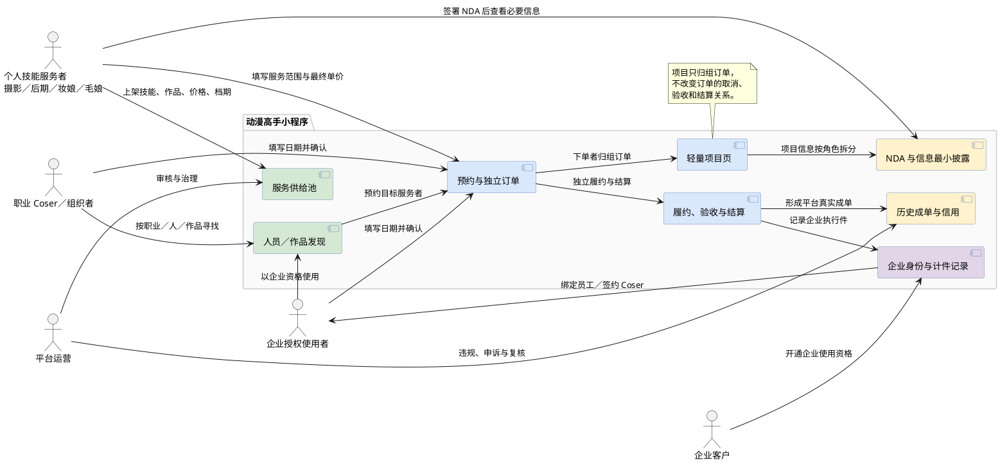
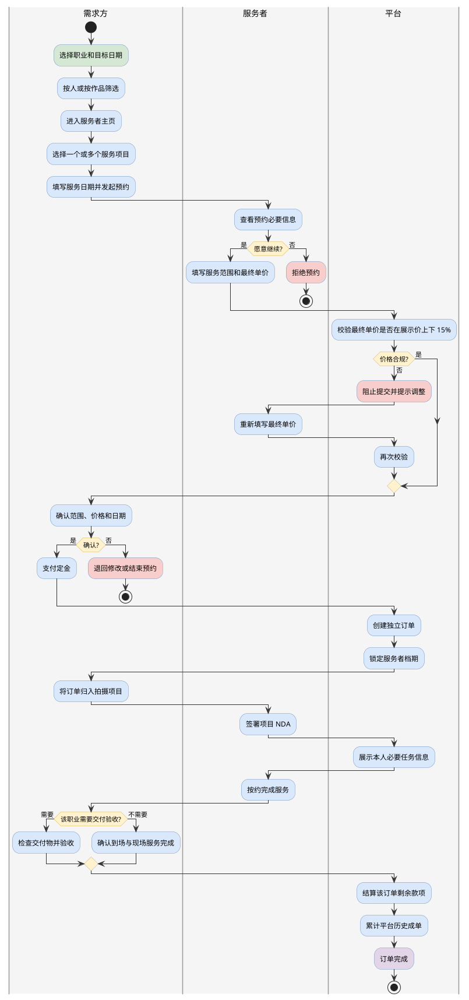
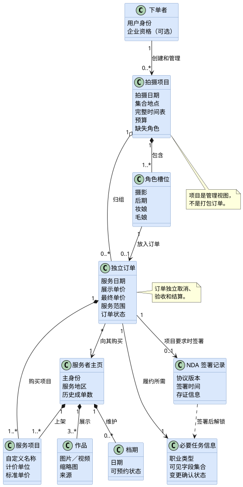
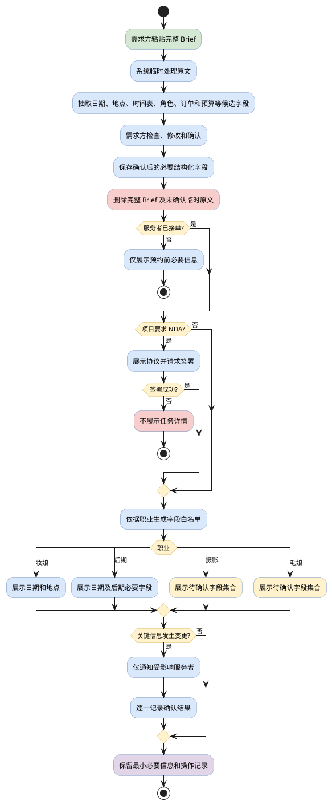

# 《动漫高手》小程序产品需求梳理 v0.2

> 文档状态：需求框架深化稿  
> 日期：2026-07-29  
> 产品阶段：前期需求确认  
> 本文依据：`requirements-discovery.md`、`prd-framework-v0.1.md` 及前期沟通结论  
> 标记规则：🔶 表示尚未验证的假设；🔵 表示需要决策或专项调研的开放问题

## 0. 本版结论

“动漫高手”首版不是 Cosplay 社区，也不是完整项目管理工具，而是：

> 面向职业 Coser、内容生产组织者和企业授权用户的个人技能服务交易平台。平台先解决摄影、后期、妆娘、毛娘的发现、审美匹配、档期确认、预约交易和独立订单管理，再用轻量项目页把多个订单归入同一次拍摄。

首版的最小业务闭环为：

1. 服务者上架个人技能、作品、价格和档期；
2. 需求方按职业、人员或作品发现服务者；
3. 双方确认日期、服务范围和最终单价；
4. 最终单价保持在展示单价上下 15%；
5. 形成独立订单并锁定档期；
6. 下单者将多个订单归入一个拍摄项目；
7. 服务者签署保密协议后，只查看本人履约所需信息；
8. 按职业完成履约确认或交付验收；
9. 单个订单独立结算并沉淀平台成单记录。

企业业务的首版重点是“企业授权身份进入上述个人交易闭环”，不是立即建设完整企业任务池、派单系统或统一企业结算。

---

## 1. Executive Summary

动漫高手是一款微信小程序，帮助职业 Coser、Coser 团队组织者及企业授权使用者，集中发现并购买摄影、后期、妆娘和毛娘等个人技能服务。它通过结构化作品集、档期、标准价格、平台历史成单和订单工具，降低跨闲鱼、小红书、微信群及熟人网络逐个找人的成本；同时用轻量项目页把多个独立服务订单组织为一次拍摄项目，在不扩张成通用协作软件的前提下，提高临时项目团队的组建效率。

🔶 **Assumption：**“发现、审美匹配、档期确认和交易缺少统一入口”是职业 Coser 当前最优先且愿意迁移到新平台解决的问题。该判断来自发起人的行业经验，尚缺少结构化访谈与行为数据。

---

## 2. Problem Statement

### 2.1 谁有问题

主要问题承担者：

- 持续生产 Cosplay 短视频、长视频和图片内容的职业 Coser；
- 为职业 Coser 组织拍摄的编导、运营、助理；
- 获得企业使用权限、需要为单次拍摄组织外部人员的员工或签约 Coser。

供给侧对应问题承担者：

- 希望获得稳定商业合作，但目前依赖小红书、闲鱼、微信群和熟人介绍获客的摄影、后期、妆娘、毛娘。

### 2.2 发生了什么

- 需求方需要在多个平台分别找人，难以统一比较作品、价格、地区和档期；
- 审美适配高度依赖作品，但作品与可购买服务、价格、档期没有形成结构化关联；
- 小红书适合发现作品和服务者，却不适合稳定进行商业交易沟通；
- 服务者资料、合作历史和信用散落在各个平台，无法形成统一且可核验的平台背书；
- 一次拍摄涉及多个独立服务者，需求方只能在微信私聊中逐个通知和确认。

### 2.3 为什么痛

对需求方：

- 找人、替补和反复确认档期耗时；
- 很难快速判断“审美合适且指定日期可用”的服务者；
- 多个独立订单缺少统一归组视图；
- 项目变更需要逐人通知，容易遗漏；
- 商业 Brief 不能无差别暴露给所有成员。

对服务者：

- 个人能力难以被结构化搜索；
- 作品流量不稳定地转化为商业询单；
- 无法通过平台真实订单持续积累信用背书；
- 重复回答地区、价格、档期、擅长与婉拒类型。

对企业：

- 员工重复跨平台组人，组织成本高；
- 低频专业工种长期雇佣的固定成本高；
- 临时项目团队的外部资源缺少统一入口。

### 2.4 已有证据和证据缺口

已有证据：

- 发起人拥有职业 Coser 合作资源；
- 已描述完整的真实找人顺序、职业分工和熟人复用行为；
- 已明确首期从江浙种子用户切入。

证据缺口：

- 🔵 职业 Coser 每月平均拍摄次数、每次外部服务订单数；
- 🔵 每个职业的真实供需量、客单价分布和档期冲突率；
- 🔵 用户愿意留在平台成交，而不是匹配后转入微信私下交易的原因；
- 🔵 服务者维护第二套作品、价格和档期资料的成本；
- 🔵 企业愿意为资源整合按“执行件”付费的价格上限。

---

## 3. Target Users & Personas

### 3.1 Primary Persona：职业 Coser／拍摄组织者

- **角色：**职业 Coser，或代表其组织拍摄的运营、编导、助理；
- **目标：**在指定日期前组齐审美匹配、预算适合的项目成员；
- **痛点：**跨平台搜索、档期反复确认、替补困难、信息分散；
- **当前行为：**按岗位逐个联系，优先复用熟人，没有合适人选时再去小红书、闲鱼或微信群寻找；
- **功能性 JTBD：**快速找到并确认一次拍摄所需的个人技能服务；
- **情绪性 JTBD：**降低“临近拍摄仍未组齐人”的失控感；
- **社会性 JTBD：**以专业、稳定的方式组织内容生产。

### 3.2 Supply Persona：个人技能服务者

- **角色：**摄影、后期、妆娘或毛娘；
- **目标：**让合适的职业客户看见作品，并获得稳定付费合作；
- **痛点：**获客入口分散，沟通重复，询单质量不稳定；
- **当前行为：**在内容平台展示作品，在私聊或微信完成档期、范围和价格沟通；
- **功能性 JTBD：**把作品、服务、价格和档期转化为可预约的商业橱窗；
- **情绪性 JTBD：**减少无效询价并得到专业认可。

### 3.3 Secondary Persona：企业授权使用者

- **角色：**MCN 员工、签约 Coser、项目运营；
- **目标：**按拍摄项目临时组织外部专业人员；
- **与 Primary Persona 的区别：**使用资格来自企业，平台未来可能依据其完成的执行件向企业计费。

### 3.4 非首版核心用户

- 普通动漫内容消费者；
- 只希望进行兴趣交流的普通爱好者；
- Cos 服、假发、道具、摄影棚等标品或场地商家；
- 寻求长期全职招聘的企业。

---

## 4. Strategic Context

### 4.1 战略目标

- 建立 Cosplay 内容生产个人技能服务的结构化供给池；
- 先用职业 Coser 的真实拍摄项目形成种子订单和平台背书；
- 通过个人交易验证供需匹配，再向企业出售资源整合和灵活用工能力；
- 避免首版同时建设社区、电商、项目管理和企业外包全套系统。

### 4.2 Why Now

- 抖音、小红书和 Bilibili 已形成持续内容生产需求；
- 越来越多爱好者向半职业和职业内容生产迁移，对成片质量和团队专业度要求提高；
- 微信已承担主要项目沟通，小程序具有免安装和便于分享的入口优势；
- 小红书等内容社区对水下交易的限制，为独立交易工具留下空间。

🔶 **Assumption：**上述趋势足以支持独立垂直平台，而非只支持微信群或通用服务市场中的一个分类。

### 4.3 商业模式边界

- 普通需求方首版不收平台服务费；
- 服务者自主定价；
- 企业层拟按完成的“执行件”收费；
- 一个项目／一次拍摄是一件业务项目；
- 一个服务者参与一次拍摄形成一个执行件；
- 🔵 企业合同、计费、开票、税务和用工关系需要专项设计。

---

## 5. 业务关系逻辑图

---

## 6. Solution Overview

### 6.1 供给上架

服务者创建一个主页，选择一个主身份，并配置一个或多个可购买服务项目。每个服务项目包含自定义名称、范围、计价单位和标准单价。主页至少展示 3 件作品，同时维护服务地区、档期、擅长类型和婉拒类型。

### 6.2 需求发现

需求方先进入摄影、后期、妆娘或毛娘职业市场，再选择：

- **按人找：**浏览服务者卡片及最多 3 张作品缩略图；
- **按作品找：**浏览双列作品流，再进入作品所属服务者主页。

两条路径最终都进入同一个服务者详情和预约入口。

### 6.3 预约交易

需求方提供服务日期并发起预约。服务者基于需求填写服务范围和最终单价，需求方确认后形成订单。最终单价必须位于对应展示单价的 85%—115% 区间。订单锁定档期，并保留展示单价、最终单价和调整比例。

### 6.4 项目归组

下单者可创建拍摄项目，把不同服务者的独立订单放入摄影、后期、妆娘、毛娘等角色位置，查看尚未补齐的角色。项目页只承担必要信息和订单归组，不承担平台聊天、文件共享和复杂任务协作。

### 6.5 保密与最小披露

用户可粘贴完整 Brief，系统只在当次处理过程中提取必要字段。用户确认后仅保存结构化结果，不保存完整 Brief。服务者接单后先签署 NDA，再查看本人履约所需字段。

### 6.6 分类履约

- 摄影、后期：有交付物，需要验收；
- 妆娘：以到场和完成现场服务作为主要履约节点；
- 毛娘：🔵 需要确定是现场服务、交付服务或两者兼有。

---

## 7. 核心交易流程图

---

## 8. 项目、订单与人员关系图

---

## 9. 信息披露与 NDA 逻辑图

---

## 10. Information Architecture

### 10.1 需求方端

1. 首页／职业入口
2. 职业市场
   - 按人找
   - 按作品找
3. 筛选面板
4. 服务者详情
5. 预约确认
6. 待确认预约
7. 订单详情
8. 项目列表
9. 项目详情
10. Brief 智能摘取确认
11. NDA 查看与签署状态
12. 验收／履约确认
13. 信用与申诉
14. 我的／企业资格

### 10.2 服务者端

1. 入驻与身份选择
2. 主页编辑
3. 服务项目管理
4. 作品集管理
5. 档期管理
6. 预约处理
7. 订单详情
8. NDA 签署
9. 必要任务信息
10. 交付／完成服务
11. 收款记录
12. 信用与申诉

### 10.3 运营后台

1. 用户与服务者审核
2. 职业与内容分类
3. 作品和主页治理
4. 订单检索
5. 项目和 NDA 记录检索
6. 违规事件、扣分、申诉和人工复核
7. 企业及成员资格
8. 执行件统计
9. 运营指标与风险监控

---

## 11. Functional Requirements

### FR-01 身份与准入

- 支持微信授权登录；
- 用户可成为需求方或申请成为服务者；
- 服务者首版选择一个主身份；
- 服务者可创建多个可购买服务项目；
- 服务者接单资格需要平台审核；
- 未成年人允许下单、限制接单的规则进入合规专项，未完成前不得默认上线。

### FR-02 服务上架

- 服务者可维护地区、简介、擅长类型和婉拒类型；
- 每个服务项目必须包含名称、范围、计价单位和标准单价；
- 主页至少有 3 件有效作品后才允许公开展示；
- 外部作品必须与平台内上传作品标记来源；
- 平台历史成单仅来自平台已完成订单。

### FR-03 发现与筛选

- 第一层按摄影、后期、妆娘、毛娘进入市场；
- 第二层支持按人找和按作品找；
- 支持指定日期、地区、服务项目、价格范围、风格／擅长类型筛选；
- 按日期筛选依据服务者公开可预约档期；
- 排序规则首版不因拒绝邀约、长期未维护档期或频繁改价扣分。

### FR-04 预约与价格确认

- 需求方输入日期并选择服务项目；
- 服务者输入最终服务范围和单项最终价格；
- 平台校验单项最终价格位于标准价的 85%—115%；
- 双方确认前允许退回修改；
- 双方确认后创建订单并锁定对应档期；
- 🔵 预约沟通是在小程序结构化表单、微信客服能力还是外部微信完成，需要确定；
- 🔵 修改次数、确认超时和档期临时保留时长需要确定。

### FR-05 订单

- 同一服务者的多个服务项目可以在一个订单中一起确认；
- 不同服务者必须分别下单；
- 订单保存展示价、最终价、调整比例、日期和范围快照；
- 每个订单独立取消、履约、验收、结算、申诉；
- 平台外费用必须醒目标记为“不进入本订单保障范围”。

### FR-06 项目

- 谁下单谁创建和管理项目；
- 下单者可把已有订单放入角色槽位；
- 展示尚未补齐的角色；
- 项目状态不得阻止单个订单独立流转；
- 关键字段变更仅通知受影响服务者并逐一确认；
- 项目页不提供聊天、文件共享、复杂分工和完整预算管理。

### FR-07 Brief 与保密

- 完整 Brief 只用于当次抽取；
- 抽取结果必须由需求方确认后保存；
- 不保存完整 Brief；
- 未确认、失败或中断的临时原文需要及时删除；
- 服务者签署项目要求的 NDA 后才能查看任务详情；
- 按职业字段白名单控制信息可见范围；
- 所有查看、签署和变更确认保留审计记录。

### FR-08 履约、验收与结算

- 摄影、后期进入交付物验收；
- 妆娘进入现场服务完成确认；
- 毛娘模型待定；
- 验收型订单需要交付、修改、验收期限和默认完成规则；
- 现场型订单需要到场和完成服务的确认凭证；
- 订单完成后累计平台历史成单；
- 🔵 定金、尾款、退款和分账必须以支付合规方案为前置条件。

### FR-09 信用与治理

- 对迟到、取消、爽约等违规行为建立事件记录；
- 扣分必须对应规则版本、证据和订单；
- 达到阈值后可限制展示、限制下单或限制接单；
- 用户可以提交申诉；
- 运营人员可以人工复核和更正；
- 信用分不替代资金退款或赔偿规则。

### FR-10 企业能力

- 平台可创建和审核企业主体；
- 企业可绑定员工和签约 Coser；
- 被授权人员进入普通交易流程，自行选人、下单和支付；
- 系统记录订单是否使用企业资格；
- 服务者参与一次企业拍摄并完成服务后生成一个执行件；
- 企业任务池、平台派单、统一企业付款和统一结算不进入当前最小闭环。

---

## 12. Success Metrics

### 12.1 北极星指标候选

**每月完成的有效人力服务订单数。**

理由：它同时要求需求被发现、供需匹配、档期确认、平台成交和履约完成，能够反映核心闭环是否成立。

🔶 **Assumption：**“完成订单数”比 GMV 更适合首期验证，因为首版尚未确定平台向个人交易收费，且各职业客单价差异较大。

### 12.2 核心漏斗

1. 进入职业市场；
2. 查看服务者详情；
3. 发起预约；
4. 服务者回填范围和价格；
5. 需求方确认；
6. 创建订单／支付定金；
7. 完成履约；
8. 完成结算。

### 12.3 建议指标

| 类型 | 指标 | 基线 | 首期目标 |
|---|---|---:|---:|
| 供给 | 完成公开主页的有效服务者数 | 待测 | 🔵 待定 |
| 供给 | 有效档期维护率 | 待测 | 🔵 待定 |
| 匹配 | 详情页到预约发起转化率 | 待测 | 🔵 待定 |
| 交易 | 预约到订单转化率 | 待测 | 🔵 待定 |
| 履约 | 订单完成率 | 待测 | 🔵 待定 |
| 效率 | 需求方组齐项目角色所需时间 | 待测 | 🔵 待定 |
| 信任 | 平台内复购率 | 待测 | 🔵 待定 |
| 质量护栏 | 取消／爽约率 | 待测 | 不高于基线 |
| 安全护栏 | 未授权信息访问事件 | 0 | 0 |
| 企业 | 企业执行件完成数 | 待测 | 🔵 待定 |

上线目标不应在没有种子用户基线的情况下凭空填写。

---

## 13. MVP Priority

### P0：必须形成闭环

- 微信登录与基础身份；
- 四职业服务者入驻；
- 主页、服务项目、作品集、地区和档期；
- 按人找、按作品找及基础筛选；
- 服务者详情和预约；
- 价格上下 15% 校验；
- 独立订单和档期锁定；
- 轻量项目页与订单归组；
- NDA 签署和最小信息披露；
- 分类履约／验收；
- 平台历史成单；
- 企业身份标记；
- 运营审核、订单查询和申诉处理。

### P0 前置决策

- 支付、定金、退款、分账方案；
- 合同主体和税务路径；
- 未成年人规则；
- NDA 签署与存证；
- 摄影、毛娘字段白名单；
- 各职业履约和验收标准。

### P1：闭环验证后

- 更丰富的推荐排序；
- 外部平台作品预览；
- 企业执行件账单；
- 自动化信用分；
- 项目变更批量通知；
- 复购和熟人服务者收藏。

### 明确不做

- 内容社区；
- 标品和场地交易；
- 平台聊天和文件共享；
- 完整团队打包下单；
- 通用项目管理；
- 企业任务池和平台统一派单；
- 对成片效果和人员必然到位作结果承诺。

---

## 14. Dependencies & Risks

| 风险类型 | 风险 | 影响 | 缓解动作 |
|---|---|---|---|
| 价值 | 用户匹配后转微信私下成交 | 平台无法沉淀交易与信用 | 用档期锁定、订单记录、企业资格、成单背书和争议处理创造留存理由 |
| 价值 | 服务者不愿维护第二套档期与作品 | 供给信息失真 | 冷启动阶段运营代录；设计低成本同步和过期提醒 |
| 可用性 | 双路径发现和多服务项目理解成本高 | 用户无法快速下单 | 用原型测试职业入口、按人／按作品切换和服务勾选 |
| 可行性 | 微信小程序支付和服务分账限制 | 交易闭环无法按设想运行 | 开发前完成支付能力和法律专项方案 |
| 可行性 | Brief 智能提取处理敏感信息 | 泄密和合规风险 | 原文不落库、最短处理链、用户确认、删除证明和审计 |
| 可行性 | 外部作品接口不可用 | 作品迁移成本上升 | P0 以平台上传为准，外部引用作为 P1 |
| 可持续性 | 平台不向个人交易收费 | 收入滞后 | 用种子交易验证企业按执行件付费意愿 |
| 法律 | 个人外包、企业用工、税务关系不清 | 无法规模化经营 | 法务、财税专项设计合同和结算主体 |
| 安全 | 未成年人参与线下拍摄 | 人身和平台责任风险 | 年龄核验、接单限制、监护规则和高风险场景治理 |
| 运营 | 争议、爽约和低质量服务依赖人工 | 冷启动运营压力大 | 首期限制城市和供给规模，保留人工审核与复核 |

---

## 15. Open Questions

### 开发前必须关闭

1. 支付链路采用什么主体、能力和资金路径？
2. 定金比例、取消、改期、退款和尾款规则如何定义？
3. 平台、企业、需求方和服务者分别签署什么合同？
4. 未成年人如何识别，允许哪些行为，是否需要监护人同意？
5. NDA 使用平台模板还是需求方模板，如何完成电子签署和存证？
6. 摄影和毛娘在预约前、接单后分别需要看到哪些字段？
7. 四职业的完成凭证、验收时限、修改次数和默认通过规则是什么？
8. 预约沟通发生在哪里，最终范围和价格如何回填并形成双向确认？

### 可在灰度期验证

9. 首发城市是杭州、上海、苏州，还是江浙沪多城？
10. 冷启动需要多少职业 Coser 和每职业多少服务者？
11. 15% 价格限制是否会导致复杂订单转为平台外费用？
12. 项目角色槽位是否只固定四职业，还是允许自定义角色？
13. 企业执行件如何处理跨日、取消、替换和多人协作？
14. 哪些因素进入推荐排序，哪些只作为筛选？

---

## 16. PRD Self-Assessment

### 最强部分

产品边界、角色关系和项目—订单关系已经清晰：平台先做个人技能服务交易；项目只归组订单；企业首版通过授权用户进入同一交易闭环。

### 最弱部分

交易资金和法律关系仍未闭合。当前“定金—履约—验收—尾款”只是业务意图，不是已经可实施的支付方案。

### 最高风险假设

| # | 假设 | 错误后果 | 建议验证 |
|---|---|---|---|
| 1 | 职业 Coser 会把平台作为主要找人入口 | 需求不足 | 用 5—10 个真实拍摄项目跑人工撮合测试 |
| 2 | 服务者愿意维护档期并留在平台成交 | 供给信息失真、交易外流 | 每职业访谈至少 5 人并测试代录主页 |
| 3 | 企业愿意按执行件付费 | 商业模式不成立 | 与 3 家 MCN 进行价格和合同意向访谈 |
| 4 | 15% 价格约束适配行业非标服务 | 大量交易规避规则 | 用历史订单回放测试价格偏差分布 |
| 5 | Brief 可被可靠地最小化提取 | 泄密或信息不足 | 用脱敏 Brief 建立字段抽取准确率测试集 |

### 推荐下一步

不要立即扩充功能。先用当前框架完成一次“真实项目回放”：选取一个合作职业 Coser 最近完成的拍摄，把找人、询价、确认、变更、履约和结算全过程映射到本 PRD，记录所有无法被当前模型表达的步骤。随后再确定 P0 页面和状态机。

