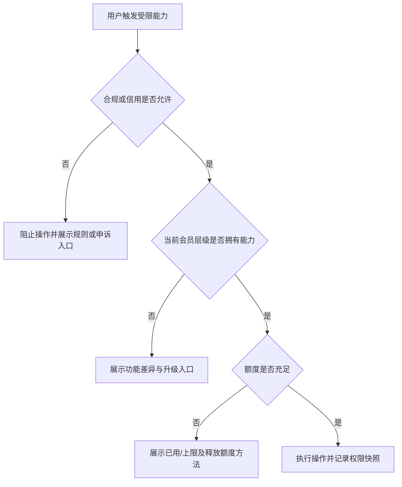

# 《动漫高手》会员权限分层矩阵 v0.1

> 2026-10-03 对照最新决定修订：本文保留历史分层讨论，不代表首发实施范围。2026-09-29用户要求先关闭“三件完整作品”限制；2026-09-30用户明确 Brief 智能抽取、企业报表、自动信用积分、会员工具全部延期。下文相关草案不再阻断首发，也不能据此恢复作品数量门槛或新增收费。C10 的会员/企业层级、企业成员授权及2/10/50协商上限是否同样延期仍待独立确认，未擅自取消。现有手动项目信息编辑保留。

> 文档性质：项目商业化草案，不是已经批准的定价方案。  
> 当前结论：需求方采用 3 档；服务方首版建议采用 2 档付费层级，并把第 3 档机构方案保留到供给侧出现真实工作室需求后再评估。认证、信用和合规资格不属于会员权益。

## 1. 分层建议

| 用户侧 | 层级 | 当前定位 | 状态 |
|---|---|---|---|
| 需求方 | 普通需求方 | 低频个人项目，验证核心交易闭环 | **已确认名称与协商额度** |
| 需求方 | 会员需求方 | 稳定产出的职业 Coser、运营或助理 | **已确认名称与协商额度**；其他权益为草案 |
| 需求方 | 企业会员需求方 | MCN／企业授权员工与签约 Coser 使用 | **已确认名称与协商额度**；主体共享方式待定 |
| 服务方 | 普通服务方 | 完成认证后即可公平参与市场和接单 | **建议草案** |
| 服务方 | 专业会员服务方 | 高频经营者的橱窗、档期和数据效率工具 | **建议草案** |
| 服务方 | 机构／工作室方案 | 多成员、多橱窗、统一结算等机构能力 | **暂缓**；不进入首版 |

## 2. 需求方权限矩阵

| 权限能力 | 普通需求方 | 会员需求方 | 企业会员需求方 | 产品表达 | 状态 |
|---|---:|---:|---:|---|---|
| 同时“协商中”订单上限 | 2 | 10 | 50 | 全局显示已用／上限；达到上限后阻止新建并引导处理现有协商 | **已确认** |
| 浏览、搜索、筛选、查看作品与作品码 | 完整 | 完整 | 完整 | 核心匹配能力不做付费墙 | **建议草案** |
| 发起预约与平台内下单 | 可用 | 可用 | 可用 | 受实名、信用、年龄和风控限制，不因会员而绕过 | **建议草案** |
| 收藏服务者／作品 | 基础额度，数值待定 | 扩展或不限，数值待定 | 企业共享收藏夹，数值待定 | 达到额度时保留已有收藏并提示升级 | **建议草案** |
| 保存搜索与筛选条件 | 少量，数值待定 | 多组，数值待定 | 企业共享模板，数值待定 | 市场页提供“保存条件”；企业可共享给授权成员 | **建议草案** |
| 项目模板 | 1 个基础模板 | 多个个人模板 | 企业级共享模板与角色预设 | 新建项目时选择模板，不改变订单独立性 | **建议草案** |
| Brief 智能摘抄额度 | 基础试用额度，待定 | 月度扩展额度，待定 | 企业共享额度或按执行件计费，待定 | 使用前显示剩余额度；只保存确认后的必要字段 | **2026-09-30明确延期；仅保留历史草案** |
| 自定义 NDA 模板 | 不提供或仅平台模板 | 个人模板，待定 | 企业模板库与版本管理 | 不影响服务方签署后最小披露规则 | **建议草案** |
| 企业成员授权 | 不提供 | 不提供 | 提供 | 企业管理员绑定员工／签约 Coser；实际使用者自行选人、下单和支付 | **已确认原则** |
| 企业用量与执行件报表 | 不提供 | 个人订单统计 | 企业成员、项目、执行件汇总 | 只统计平台内订单；一次拍摄中每位服务方参与一次计一个执行件 | **企业报表2026-09-30明确延期；历史统计原则保留** |
| 账单导出与企业服务支持 | 基础订单记录 | 个人汇总导出，待定 | 企业账单、成员维度导出与服务支持 | 不改变用户自行支付的首版交易关系 | **建议草案** |

## 3. 服务方权限矩阵

| 权限能力 | 普通服务方 | 专业会员服务方 | 机构／工作室方案（暂缓） | 产品表达 | 状态 |
|---|---|---|---|---|---|
| 通过认证后公开橱窗与接单 | 可用 | 可用 | 待定 | 核心供给能力不做付费墙；会员不能替代认证 | **建议草案** |
| 职业身份与橱窗数量 | 1 个身份／1 个橱窗 | 首版仍为 1 个身份／1 个橱窗 | 多成员／多橱窗待研究 | 会员不绕过首版单一身份规则 | **已确认边界** |
| 公开作品最低数量 | 三件完整作品限制已关闭 | 不据会员恢复数量门槛 | 待定 | 仍须满足当前服务资料、资格与本人确认发布规则；保存草稿不等于公开 | **2026-09-29用户决定覆盖旧的至少3件要求** |
| 可管理作品总量 | 基础上限，数值待定 | 扩展上限，数值待定 | 机构共享素材库待定 | 不同层级只改变管理容量，不改变作品审核标准 | **建议草案** |
| 作品引用数据 | 查看总引用量 | 单作品趋势、来源职业和周期分析 | 团队汇总分析待定 | 只展示脱敏聚合数据，不泄露需求方保密项目 | **建议草案** |
| 档期可维护范围 | 基础未来周期，待定 | 更长周期与批量设置 | 多成员排期待定 | 市场始终读取同一公开档期源 | **建议草案** |
| 批量管理工具 | 基础逐项编辑 | 批量修改档期、价格和标签 | 多成员批量管理待定 | 会员销售效率，不销售合规豁免 | **建议草案** |
| 橱窗经营数据 | 基础浏览／询单总数 | 漏斗、作品引用、转化与周期对比 | 团队数据待定 | 数据口径只覆盖平台内行为 | **建议草案** |
| 企业合作机会 | 可获得 | 可获得 | 可获得 | 企业订单不能仅因未付服务方会员而不可见 | **商业护栏草案** |
| 搜索自然排序与信用背书 | 同一质量规则 | 同一质量规则 | 同一质量规则 | 不售卖虚假“高信用”；如未来售卖广告位必须明确标“推广” | **商业护栏草案** |
| 接单数量、年龄与处罚限制 | 按统一规则 | 按统一规则 | 按统一规则 | 会员不能提高风控上限或解除处罚 | **建议草案** |

## 4. 不应会员化的能力

| 能力 | 原因 |
|---|---|
| 实名／年龄／服务方资质审核 | 属于准入与合规，不能购买 |
| NDA 签署和最小信息披露 | 属于保密安全，不能购买绕过 |
| 订单申诉与基本售后 | 属于交易基础权利，不应按会员差别对待 |
| 信用分、平台成单和历史履约 | 必须来自真实行为，不能付费获得 |
| 违规处罚、接单限制和下单限制 | 属于平台治理，会员不能豁免 |
| 未标识的自然搜索排序加权 | 会破坏审美匹配与市场可信度 |

## 5. 权限判定与页面表达

- 判定顺序必须是：合规／信用 → 会员能力 → 数量额度，不能先展示付费升级再告知用户被合规禁止。
- 所有关键判定由服务端执行，订单保存下单时的权限与规则快照。
- 会员到期后，存量协商和订单继续处理；禁止新建超出新层级额度的对象。
- 企业会员的权限主体必须单独确定：企业共享额度、员工个人额度或两者组合不能混用。

## 6. 当前建议与待决策

### 当前建议

1. 需求方先采用 3 档，因为 2／10／50 的协商额度已经形成明确层级。
2. 服务方首版只采用普通／专业会员 2 档，先售卖容量、批量工具和经营数据，不提前建设机构账户。
3. 企业会员的价值重点放在成员授权、共享模板、执行件报表和组织效率，不靠抬高自然排序。
4. 认证、信用和会员三套体系从数据模型到界面标识都保持独立。

### 待决策

1. “协商中”额度按企业共享还是员工独享计算。
2. 收藏、保存筛选、项目模板、Brief 摘抄等具体额度。
3. 服务方作品容量、档期维护周期和数据分析周期。
4. 需求方会员、企业会员采用订阅制、按件计费还是组合计费。
5. 服务方会员是否在冷启动期收费，以及免费试用和迁移策略。
